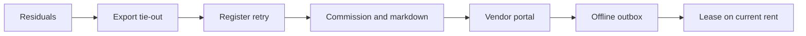

# Perfect Consign — Ledger-first build plan

**Status:** the build sequence, October 2026
**Codebase:** `perfect-consign`, PHP 8.5, PostgreSQL 18, schema-per-tenant

[MASTER-PLAN.md](MASTER-PLAN.md) law still holds. This file is the build sequence. Where the two disagree, this file wins for the next build.

## Law carried forward

Money is a journal. PHP, the worker, and the browser submit drafts. PostgreSQL posts or refuses. Balances stay views. A mistake is a dated reversal. Schema changes are new files under `sql/`, numbered after `sql/018_mail_sealed_only.sql`. A stamped file is never edited. Identifiers stay `uuidv7()`. Tenant data stays in the tenant schema, with no `tenant` column on tenant tables. No feature flags on posting rules. No columns for ACH, channels, or 1099s until that feature is the one being built.

A workstream is done when its refusal is in `sql/prove_*.sql`, that proof is on `composer check`, the PHP path has a real HTTP or integration test, and the edited path has been executed once in that session. No new file over 500 lines. PHPStan level 10. Coverage floor stays 90%.

## Sequence

One engineer. Calendar slips before a later phase starts. Week counts below are the budget for that phase, not a promise that the calendar date survives a red proof.

### 1. Residuals — about one week

Round 4 is not the backlog anymore. `sql/017_job_mail_sent.sql` and `src/Shared/Jobs/DigestJob.php` already skip a recipient who was sent and continue past a waiting letter. `sql/018_mail_sealed_only.sql` accepts only a `v1:` mailbox secret. `src/Feature/Password/ResetLetter.php` catches a mailbox failure and `src/Feature/Password/ForgotController.php` ignores the boolean.

Still do this before product work:

- Add one `php bin/work.php` pass to the `check` script in `composer.json`. It is absent today. The pass runs against the provisioned database and asserts the claimed jobs finish.
- Add the HTTP test that a forgot-password submit for an unknown username and a known username returns the same notice, including when the mailbox key is missing.
- Revoke the Gmail app password that remains in git history. Do not copy that address into new files under `ninja/`. History purge stays an operator decision.

### 2. Export tie-out — about one week

QuickBooks and Xero CSV already exist. `stall_export_journal_csv()` in `sql/001_tenant.sql` writes one row per journal line, mapped through `export_accounts (system, role, external_code)`, and puts the vendor or booth name on the QuickBooks Name column. `bin/export-journals.php` and `src/Feature/Export/ExportStore.php` already call it.

Build the tie-out on that function. For a chosen period, the CSV debit and credit totals equal `account_balances` for the roles the file claims. A non-zero delta refuses period close. Close runs only after the tie-out passes. A second export of a closed period is byte-identical, because `sql/prove_period_close.sql` already refuses a journal in a closed period. A hash change on a closed period fails the proof.

IIF is a later writer over `export_lines` and the same `export_accounts` rows, and only after that tenant's accountant rejects this CSV in writing. There is no second mapping table and no one-journal-per-month file.

### 3. Register retry — about six weeks

The sale, tender, park, recall, void, and return commands become same-origin JSON actions behind the current session and CSRF. The browser sends the ticket. Tax, commission, and stock stay in SQL.

The posting key is `uuidv7()`, created when the ticket opens, and stored with the ticket before tender. A retry sends that same key. The receipt number is `journal_no`, which the insert trigger in `sql/001_tenant.sql` assigns. The screen can say the sale is not posted until that number exists.

Exit: add-line and pay do not reload the document; a refused post shows the database refusal; the HTTP suite covers the commands; a double submit creates one journal.

### 4. Commission tiers and markdowns — about four weeks

Tiers land in a new migration as `stall_commission_for`, called from the sale-line insert path that today does `COALESCE(item.commission_bps, vendor.commission_bps, mall.commission_bps)` in `sql/001_tenant.sql` around the sale-line trigger. The stored fact remains `sale_lines.commission_minor`. Historical lines are never recomputed.

`prove_commission_precedence.sql` covers overlapping rules, priority then specificity then effective date, prices exactly on `min` and `max`, and expired rules. Two rules that are equally specific, equally prioritized, and differently rated are rejected at write time.

Markdowns are a queue. A daily job proposes the next price and prints a re-tag list. The item price changes when the re-tag is confirmed. A parked ticket keeps the price it was parked with. A floor blocks a price below the floor unless a manager override is the audit actor. Items on hold are skipped. The proof shows an in-flight ticket posting the price it captured.

### 5. Vendor portal — about three weeks

Server-rendered. Magic-link login uses the same identical-response and rate-limit discipline as password recovery. Opaque tokens in URLs.

Authorization is a `stall_vendor` role and security-barrier views. The request sets `stall.vendor_id` inside the transaction. The proof shows that a missing setting returns no rows, and that another vendor's token returns no rows. Application `WHERE` clauses are not the guarantee.

Screens: items and status, sales, payable, next payout, items about to expire, and the signed agreement. Payout preference is check or hold. Store credit becomes a choice only when a disbursement source type already posts it.

Out of scope: self-service intake, messaging, and a request-payout button.

### 6. Offline outbox — proofs first, then the client

Start this only after phase 3 is in daily use. Write `sql/prove_offline_sync.sql` and the HTTP sync test before IndexedDB.

The outbox row stores the posting key, the business date, and the price, tax, and commission snapped at the register. Sync posts that snapshot. The server does not re-resolve commission from the current rules. On reconnect, catalog refresh updates the next sale. It does not reprice a sale already snapped.

Refusals the sync must return, one record at a time: duplicate key, closed period, insufficient quantity, missing item, permission. A refused record stays on a needs-attention list with the cash still in the drawer. The close screen shows unsynced snaps and refused snaps as separate figures.

Two registers can both ring the last unit. The database `FOR UPDATE` on the item lets one post. The other stays unposted. The cashier return or a manager adjustment is the only way that cash meets the books.

Nothing prints `journal_no` until the insert commits. An offline slip says the sale is not posted. `src/Bootstrap/ActiveRegister.php` stays the open-drawer pointer. Receipt-number blocks are not added.

A sale dated on the 30th posts to the 30th only while that period is open. After close, sync returns `closed period`. There is no 7-day bypass of `sql/prove_period_close.sql`.

Service-worker caching of the register shell can follow once those proofs pass. Permission caches do not.

### 7. Booth leases — about two weeks, on the current rent key

A lease is metadata for a booth assignment: dates, rent, deposit, status. A PostgreSQL exclusion constraint on `(booth_id, daterange)` refuses two active overlaps.

Rent still posts as `rent-charge:{booth}:{period}` through the existing job, the key already enforced in `sql/001_tenant.sql`. The lease supplies the amount. It does not create a second charge. Deposits stay on `2151 booth_deposit_held`. Mid-month start, proration, and early termination each get a case in `sql/prove_rent_charge.sql` or a new proof that includes the old cases.

## Triggered later

Each starts only on its trigger, as its own plan.

- IIF writer over `export_lines`: the tenant's accountant rejects the current CSV in writing.
- ACH: a vendor disbursement must move electronically. Add `payout_method` in that migration.
- Online selling: a paying mall sells online. Shopify is its own sale source and its own assertion.
- 1099-NEC: an accountant signs the field list.
- Customer store credit as a payout method: the disbursement source type exists.
- Multi-location: the first mall opens a second site.

## Definition of done

Every phase above ends on a green `composer check`, including the worker pass from phase 1. A money change also runs the two-session case: one session holds the posting key or the row lock, the other inserts, and both committing fails. Offline is not done when the happy-path sync works. It is done when the closed-period, last-unit, and new-key cases refuse and the drawer shows the refused cash.
